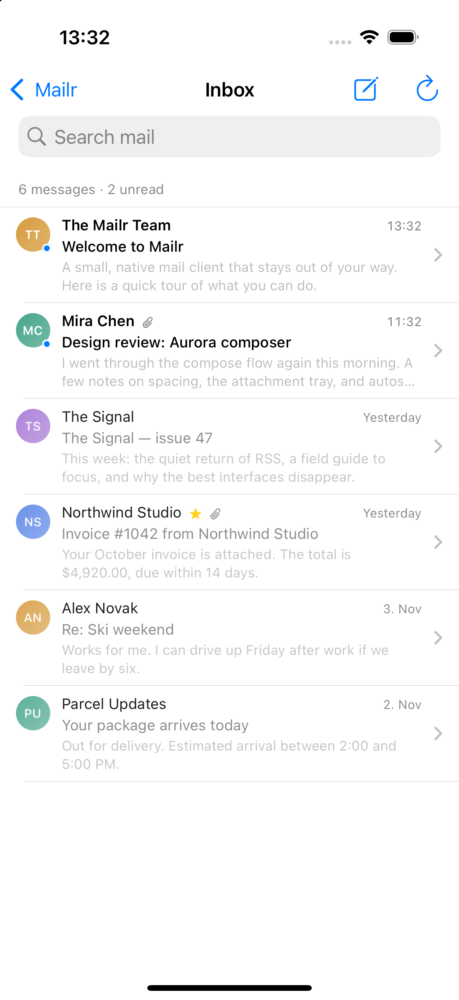
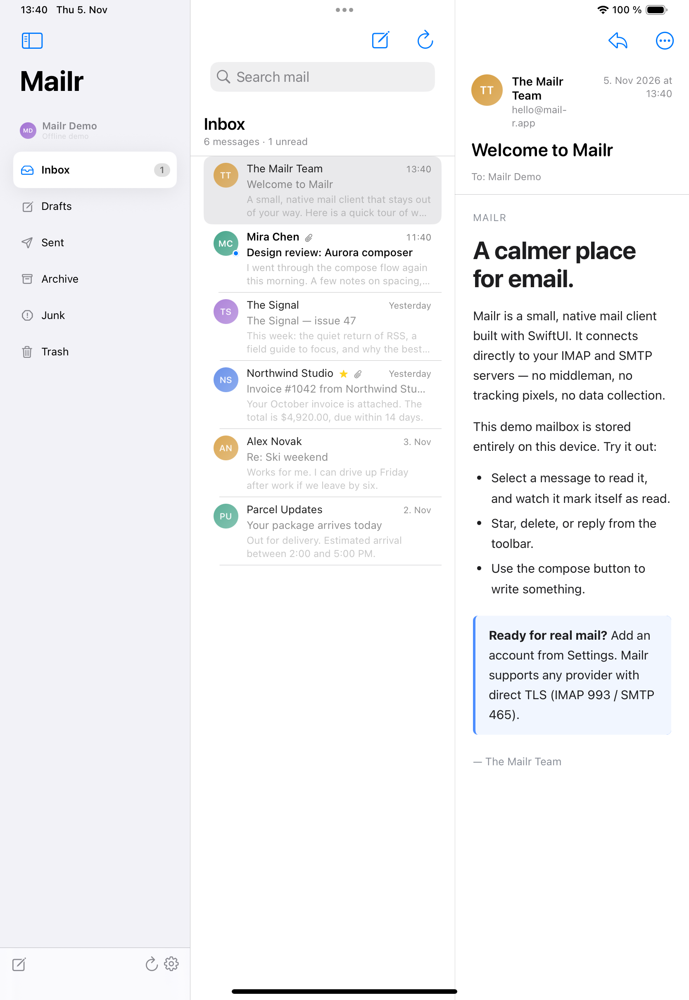
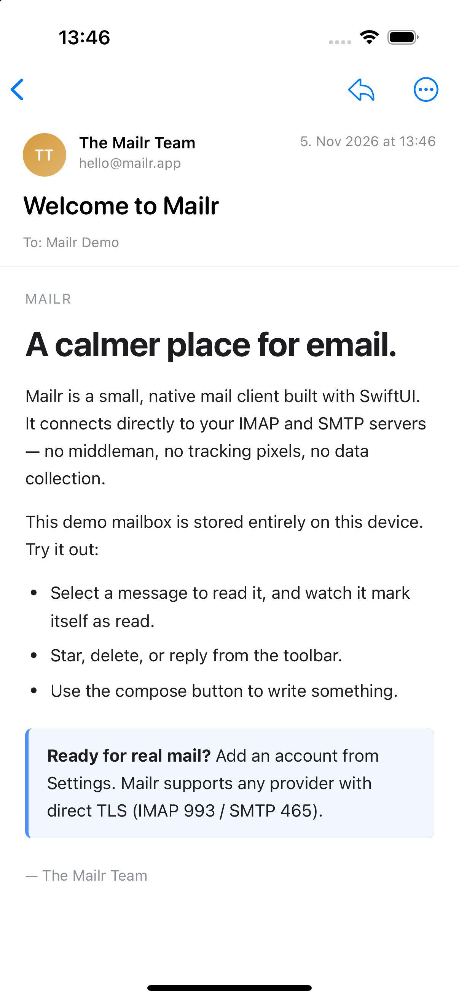
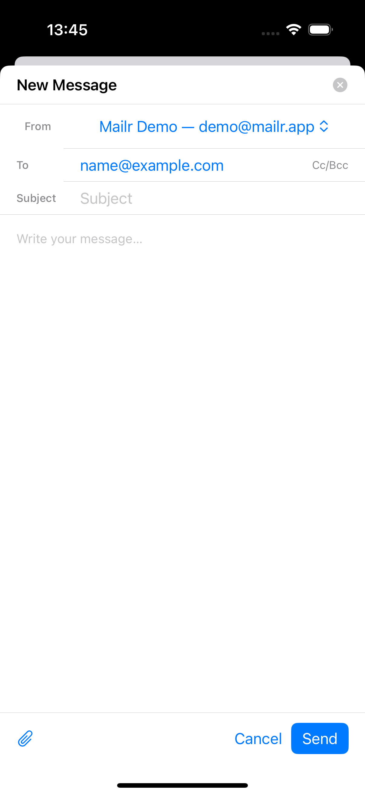
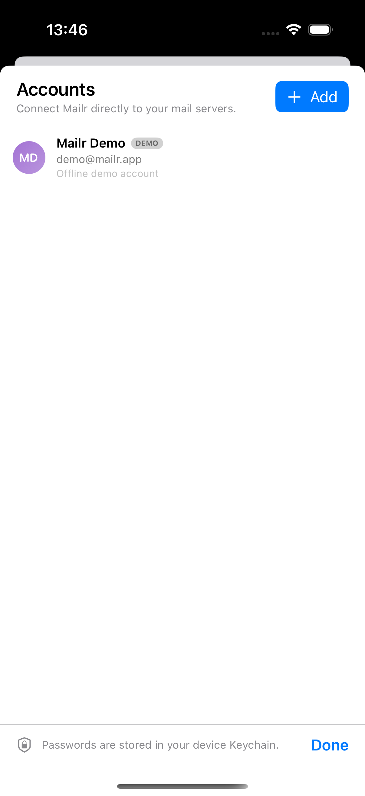
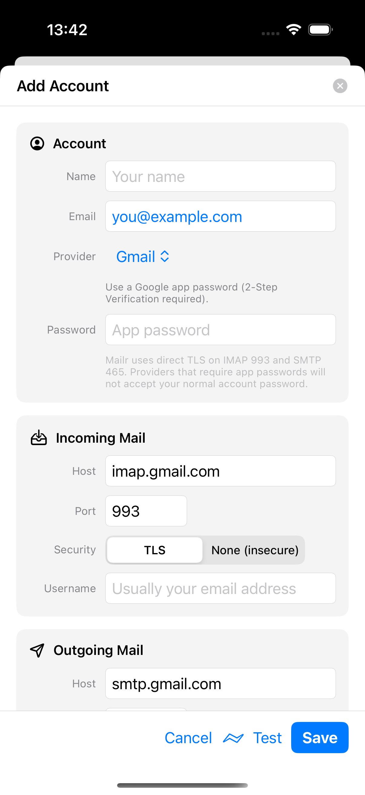
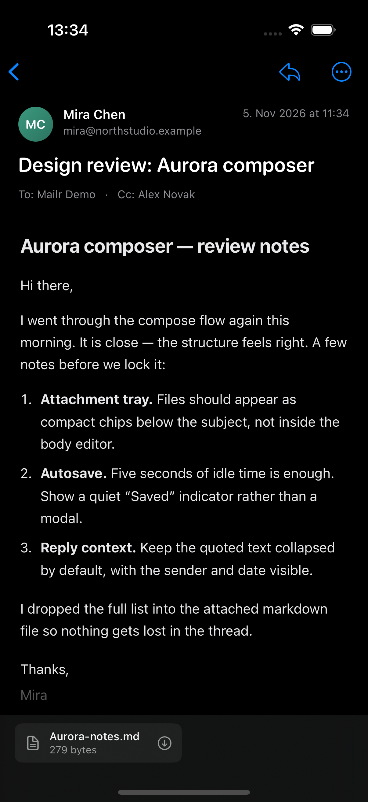

# Mailr

A native, privacy-first mail client for **iPhone and iPad**, with a macOS build from the same SwiftUI codebase. Mailr talks directly to IMAP and SMTP servers — there is no proxy, no account server, and no telemetry. It ships with a local demo mailbox so you can try the whole interface before configuring an account.

<br>

| iPhone | iPad |
| :---: | :---: |
|  |  |

| Reader | Compose |
| :---: | :---: |
|  |  |

| Accounts | Add account | Dark mode |
| :---: | :---: | :---: |
|  |  |  |

## Documentation

Full documentation lives at **https://403access.github.io/mailr/**. The site is a Docusaurus app in `website/`, deployed to GitHub Pages by `.github/workflows/deploy-docs.yml` on every push to `main` that touches it.

```bash
make docs        # local dev server at http://localhost:3000/mailr/
make docs-build  # production build
```

## Features

- **iPhone-first navigation.** Mailboxes live in a slide-in drawer, so the message list is the root screen; messages push into the reader. iPad and Mac use a three-column split view.
- **Real IMAP.** Mailbox discovery, unread counts, message lists, flags, mark read/unread, flagging, moving, and deleting to Trash.
- **Real SMTP.** Multipart text/HTML messages, attachments, In-Reply-To/References headers, and a best-effort copy in the Sent folder.
- **A real MIME engine.** Multipart trees, base64 and quoted-printable, RFC 2047 encoded words, RFC 2231 filenames, charset conversion, and inline `cid:` images turned into data URLs.
- **Safe HTML reader.** JavaScript is disabled, a strict Content Security Policy is applied, and remote images are blocked until you explicitly load them. Link clicks open in your browser.
- **Attachments.** View, download/save with the system file exporter, or attach files while composing.
- **Demo mode.** A seeded offline mailbox with attachments, HTML mail, drafts, and sent mail. Demo changes are stored in SQLite and survive relaunches.
- **Synchronous local storage.** Accounts, mailboxes, message summaries, bodies, and attachments live in a single SQLite database, so cached mail is available offline and across launches.
- **Platform integration.** Keychain password storage, dark mode, search, pull-to-refresh, and adaptive sheets.
- **App Lock.** Optional Face ID or Touch ID (with device passcode fallback) when Mailr launches or returns to the foreground. Manage it under Settings → Privacy → App Lock.
- **No third-party dependencies.** Only Apple frameworks and the system SQLite library: SwiftUI, WebKit, Network, Security, LocalAuthentication, Foundation, and SQLite3.

## Quick start

Requirements: **Xcode 16 or newer** (Swift 6), **iOS 17+**, **macOS 14+**. The checked-in project was built with Xcode 27 / Swift 6.4.

### iOS / iPadOS

```bash
# Regenerate the Xcode project if you changed project.yml (optional)
make ios-project

# Build and launch in the iPhone simulator
make ios-run
```

Or open `Mailr.xcodeproj` in Xcode, choose the **Mailr** scheme, and press Run. To install on a connected iPhone or iPad:

```bash
make device-install
```

The defaults target the connected iPhone and the configured Apple Development team. Override them with `DEVICE=<UDID>` and `TEAM=<team ID>` if you switch devices or accounts. Automatic signing creates the provisioning profile and keychain access group; you can also just press Run in Xcode after selecting your team.

The project is generated with [XcodeGen](https://github.com/yonaskolb/XcodeGen). Edit `project.yml` rather than the `.xcodeproj` when changing build settings or adding new source folders.

### macOS

```bash
make run        # builds build/Mailr.app and opens it
make app        # builds the .app bundle only
```

The macOS app is built with Swift Package Manager and assembled into a proper `.app` by `Scripts/build-app.sh`. It shares `MailCore` and essentially all SwiftUI views with iOS.

## Connecting a real account

1. Open the ellipsis menu on iPhone (or Settings on Mac).
2. Tap **Add**, choose a provider preset, and enter your email address.
3. Enter an **app-specific password** when the provider requires one, then tap **Test** and **Save**.

| Provider | IMAP | SMTP | Notes |
| --- | --- | --- | --- |
| iCloud | `imap.mail.me.com:993` | `smtp.mail.me.com:465` | App-specific password from appleid.apple.com |
| Gmail | `imap.gmail.com:993` | `smtp.gmail.com:465` | Google app password; 2-Step Verification required |
| Yahoo | `imap.mail.yahoo.com:993` | `smtp.mail.yahoo.com:465` | App password |
| Fastmail | `imap.fastmail.com:993` | `smtp.fastmail.com:465` | App password |
| Zoho | `imap.zoho.com:993` | `smtp.zoho.com:465` | App-specific password when 2FA is enabled |
| Custom | Your server | Your server | Direct TLS on the chosen ports |

Mailr deliberately uses **implicit TLS** (IMAP 993 / SMTP 465). STARTTLS-only endpoints are not supported yet, so providers that require SMTP submission on port 587 (for example Outlook/Microsoft 365) can receive mail but cannot send through Mailr. The “None (insecure)” option exists only for local development servers; Mailr warns when it is selected.

## Architecture

```
Sources/
  MailCore/                 Cross-platform engine (also a SwiftPM library)
    Models.swift            Accounts, mailboxes, messages, attachments, errors
    MIMEHeader.swift        Header maps, RFC 2047/2231, charsets, structured headers
    MIMEParser.swift        MIME tree, transfer decoding, body/attachment extraction
    IMAPSupport.swift       IMAP tokenizer/parsers, modified UTF-7, fetch records
    IMAPClient.swift        Async IMAP client, literals, flags, move, append
    IMAPMailService.swift   Account-level service with reconnects
    SMTPClient.swift        EHLO, AUTH LOGIN/PLAIN, DATA, dot-stuffing
    MessageBuilder.swift    RFC 5322 / MIME composition
    SocketConnection.swift  Async TLS byte stream on Network.framework
    MailService.swift       Service protocol, account store, Keychain store
    MailDatabase.swift      Synchronous SQLite store for local mail data
    DemoMailService.swift   Seeded offline mailbox
  Mailr/                    SwiftUI app
    AppModel.swift          MainActor observable state and actions
    RootView.swift          Adaptive iPhone / iPad+Mac shells
    SidebarView.swift       Accounts, mailboxes, iPhone mailbox drawer
    MessageListView.swift   Message browser and rows
    MessageDetailView.swift Reader, actions, attachment export
    HTMLMessageView.swift   Locked-down WKWebView (iOS and macOS)
    ComposeView.swift       Compose sheet and file importer
    SettingsView.swift      Account management and Privacy entry
    AccountEditorView.swift Provider presets, IMAP/SMTP settings, test
    AppLock.swift           Face ID / Touch ID lock state via LocalAuthentication
    LockScreenView.swift    Opaque unlock cover
    SecuritySettingsView.swift App Lock setup page
    Platform.swift          iOS/macOS conditional helpers
Tests/MailCoreTests/        Parser, builder, IMAP, and demo-service tests
project.yml                 XcodeGen definition for the iOS app
Support/Info.plist          macOS bundle metadata
Support/Mailr.entitlements  iOS Keychain access group
Support/Icon/               Generated app-icon masters
Scripts/build-app.sh        macOS .app bundler
Scripts/make-icon.sh        Regenerates the app icon (macOS + iOS)
website/                    Docusaurus documentation site (GitHub Pages)
.github/workflows/          Docs deployment workflow
```

`MailCore` has no UI dependencies and can be reused. The iOS target compiles it as an embedded framework; the macOS target consumes the same sources as the `MailCore` SwiftPM library.

## Tests

```bash
swift test
```

The suite covers:

- RFC 2047 encoded words and address lists
- Header unfolding, RFC 2231 filenames, quoted-printable
- Multipart extraction, HTML/plain selection, inline content, snippets
- IMAP list/status/fetch-literal parsing and modified UTF-7
- MIME message building, header-injection defense, CRLF correctness
- Account, mailbox, message, body, and attachment persistence in SQLite
- Legacy `accounts.json` migration into SQLite
- Demo mailbox reads, flags, send, move-to-Trash, and relaunch persistence

All 32 tests pass on macOS. The iOS app itself is verified by building and launching in the simulator.

### Debug UI previews

Debug builds understand a `MAILR_UI_PREVIEW` environment variable so screenshots and simulator runs can jump directly to a screen:

```bash
SIMCTL_CHILD_MAILR_UI_PREVIEW=message \
  xcrun simctl launch --terminate-running-process booted app.mailr.Mailr
```

Modes: `inbox`, `drawer`, `message`, `attachment`, `compose`, `settings`, `security`, `account`. The hook is compiled out of release builds.

## Security and privacy

- Passwords live in the **macOS/iOS Keychain**, keyed by account UUID. Account metadata, cached mailboxes, message summaries, bodies, and attachments are stored in a **SQLite database** in Application Support (`Mailr/mailr.sqlite3`). Existing `accounts.json` files are imported once and renamed.
- TLS is handled by **Network.framework** with the system trust store and a 30-second connect timeout. Credentials are only sent after the TLS connection is established, unless the user explicitly selects the insecure plaintext option.
- The HTML reader disables JavaScript, uses a non-persistent web data store, injects a restrictive CSP, and blocks remote images by default to prevent tracking pixels.
- **App Lock** is optional and off by default. Once enabled, authentication runs through **LocalAuthentication** (Face ID, Touch ID, or the device passcode). Mailr only receives success or failure; biometric data never leaves the device. With App Lock enabled, Mailr locks at launch and whenever it returns from the background; the preference is stored in `UserDefaults`.
- There is no analytics, crash reporting, or remote logging.

## Limitations / possible next steps

- No OAuth sign-in (app passwords only).
- No STARTTLS upgrade; direct TLS only.
- No background push or scheduled sync. Mail refreshes on launch, when the app becomes active, on pull-to-refresh, and manually.
- Message lists fetch the newest 100 messages and search is local. There is no server-side search yet.
- Compose does not autosave drafts, and there is no conversation/thread view or undo-delete.
- Attachments are downloaded on demand from the full message body; there is no BODYSTRUCTURE-based lazy attachment fetching.
- The local cache stores the newest 100 messages per mailbox; older mail is fetched from the server when it returns to the window.
